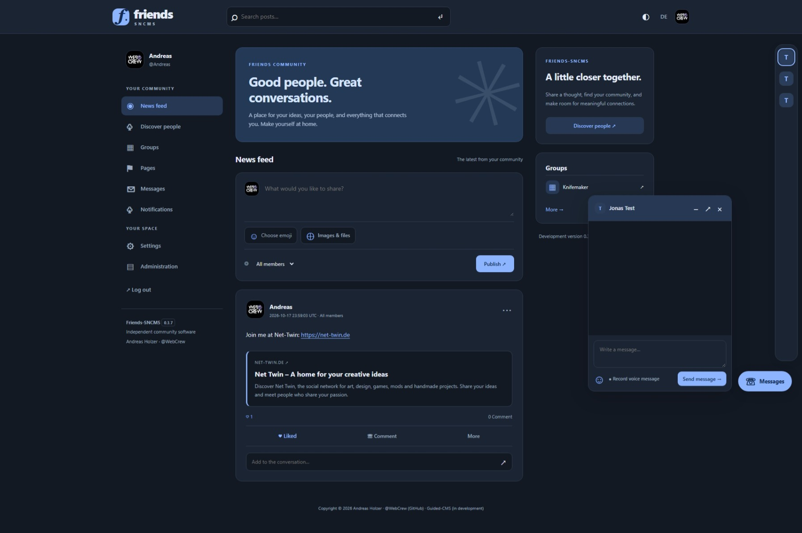

# Friends-SNCMS

**A free Open Source Social Network System.**

Created by **Andreas Holzer · [@WebCrew](https://github.com/WebCrew)**. Free to use, modify and redistribute under the [MIT license](LICENSE).

**Version 1.0.0 · First public Final release** · PHP 8.4 · MySQL 5.7 target · English / Deutsch

**Donations are always voluntary and support the project.** If Friends-SNCMS helps your business earn money, or you sell themes or plugins for it, please consider giving back through a donation. No donation, subscription or license key is required, including for commercial use. [Support the project](SUPPORT.md).

[Download the installer ZIP](https://github.com/WebCrew/Friends-SNCMS/releases/latest) · [Installation](docs/INSTALL.md) · [Wiki](https://github.com/WebCrew/Friends-SNCMS/wiki) · [Community](https://github.com/WebCrew/Friends-SNCMS/discussions) · [Themes & plugins](docs/EXTENSIONS.md)

## Your people. Your place.

A compact, understandable community foundation with a responsive flat interface, day/night modes and Blue or Ember Orange accents. The core stays focused; the community can build original extensions around it.

- Three-step installer: extract, upload all folder contents, open your URL. No manual SQL import.
- Email-verified registration, password recovery, account settings and profiles with About/social links, avatar and header.
- Feed with emoji picker, images/files, automatic link cards, comments, likes, search, reporting and audience controls.
- Friendship requests, private text/emoji chat, recorded voice messages and a shared live microphone room for six simultaneous speakers.
- Groups and pages with their own logos/covers, membership/following and notifications.
- Clear administration navigation, member editing, moderation, spam controls and configurable upload size/attachment count.
- Bilingual static/legal pages, mail/SMTP configuration, contact form and opt-in newsletter.
- Integrated plugin hooks and installable original ZIP packages; CSS themes and DE/EN interface dictionaries.
- Local assets without third-party fonts, tracking or mandatory paid APIs. Extensions start disabled and require administrator trust.

Read the [feature guide](docs/FEATURES-0.3.md), [interface guide](docs/INTERFACE-0.3.3.md), [automatic link cards](docs/AUTOMATIC-LINKS.md) and [architecture](docs/ARCHITECTURE.md).

## Install: extract, upload, open

1. Download **Friends-SNCMS-1.0.0-Webspace.zip** from [Releases](https://github.com/WebCrew/Friends-SNCMS/releases/latest), extract it and open the Friends-SNCMS folder.
2. Upload **all its contents**, including the hidden **.htaccess**, into your webspace directory.
3. Open your directory's HTTPS URL. The installer starts automatically; install.php is also available.
4. Follow the server check, empty database connection, and community/administrator setup steps.
5. Configure sender, mail transport and canonical HTTPS URL under **Admin → Email settings**, then send a test email before opening registration.

**Upload the whole folder contents, including internal folders.** Your domain does not need to point at public/. Create an empty database in your hosting panel first; the installer creates its tables.

### System requirements

- PHP 8.4+, PDO MySQL, fileinfo, GD, cURL, ZIP and OpenSSL; the installer checks applicable extensions.
- MySQL 5.7 / InnoDB / utf8mb4 compatibility target. See [validation](docs/VALIDATION.md) for actual tested environments.
- Apache 2.4 or compatible LiteSpeed with active .htaccess/rewrite protection. Nginx/IIS need equivalent administrator-configured protection.
- HTTPS for hosted use and microphone permission for audio. Normal PHP shared hosting runs the CMS and signaling.
- Upload sizes/count are set in administration. PHP upload_max_filesize, post_max_size and max_file_uploads also apply. Daily quotas and the 250 MB total storage quota per member remain in effect.

**Live voice:** Six participants share one room; this does not limit community membership or private text chats. Some networks need a separate TURN relay. A self-hosted open-source relay avoids a mandatory service subscription; ordinary PHP shared hosting usually cannot run the relay itself. [Voice setup](docs/VOICE-SETUP.md).

[Full installation/recovery](docs/INSTALL.md) · [Email verification and recovery](docs/ACCOUNT-MAIL.md) · [Chat and audio](docs/CHAT.md)

**Updating from 0.3.x:** Back up your database, private storage, plugins and themes. Preserve storage/config.php and all runtime files. This release retains schema 3; copying release files must not erase private content. Older schema-2 upgrades follow the documented additive update; schema-1 upgrades are unsupported.

## Themes, plugins and community

Browse and publish extensions in **[Discussions](https://github.com/WebCrew/Friends-SNCMS/discussions)** under **Plugins** and **Themes**. Each entry lists the author, original source, license, free/paid status, API/CMS compatibility, installation and support. Entries are community submissions, not a security endorsement.

Start with the [extension directory and submission rules](docs/EXTENSIONS.md) and [API-1 package format](docs/PACKAGES.md). No automatic downloads or installation from the catalog.

[Report a reproducible bug](https://github.com/WebCrew/Friends-SNCMS/issues/new/choose) · [Propose a change](https://github.com/WebCrew/Friends-SNCMS/issues/new/choose) · [Ask for help](https://github.com/WebCrew/Friends-SNCMS/discussions)

For vulnerabilities, use [private reporting](https://github.com/WebCrew/Friends-SNCMS/security/advisories/new), never a public issue.

## Support independent development

Friends-SNCMS stays free, including commercial use. Donations help sustain development, maintenance and project documentation. **Business operators and developers selling themes/plugins are especially encouraged to support the core they build on.** This is a request, never a payment obligation or license condition. Contributing code, translations, testing and helping others are also valuable.

## Contribute

Read [CONTRIBUTING](CONTRIBUTING.md) ([Deutsch](docs/CONTRIBUTING.de.md)), [governance](GOVERNANCE.md), [code of conduct](CODE_OF_CONDUCT.md) and [security](SECURITY.md). Submit focused PRs; keep DE/EN complete, preserve PHP 8.4/MySQL 5.7 compatibility, test relevant behavior and disclose substantial AI assistance. New features/dependencies/API changes need scope agreement first.

Main is protected. Contributors work through forks and reviewed pull requests; participation or donations do not confer write access. Canonical documentation and policy live in repository files; the collaborator-edited Wiki links to them.

### Validation and release scope

The 1.0.0 Final label marks the owner's first public release after online testing; it is not an independent security certification. Automated checks cover syntax, isolated integration scenarios and a MySQL 5.7 CI smoke test. [Validation details](docs/VALIDATION.md) distinguish completed checks from remaining physical microphone/cross-network and independent review work. No test result should be inferred from the version label.

Run bin/check.ps1 on Windows for local checks. CI runs the PHP/JavaScript and MySQL checks on Linux. Synthetic audio and SQLite do not establish every hosting/device combination.

## From the creator

**Andreas Holzer · @WebCrew** builds independent web software. Friends-SNCMS is a free contribution and a practical, readable base for a community to develop further.

**Also in development: Guided-CMS.** Follow [@WebCrew](https://github.com/WebCrew) for future projects and company news.

Friends-SNCMS is an original implementation. No source, schema, themes, documentation or assets from the inspected abandoned CMS or Sngine are distributed.

## Deutsch

**Ein kostenloses Open-Source-Social-Network-System von Andreas Holzer @WebCrew.** Version 1.0.0 ist unsere erste öffentliche Final-Version: eine bewusst überschaubare Basis, die die Community mit eigenen Themes und Plugins ergänzen kann.

**Installation:** ZIP entpacken, den kompletten Inhalt des Ordners Friends-SNCMS einschließlich .htaccess auf den Webspace hochladen, URL öffnen und dem Installer folgen. Kein manuelles SQL-Importieren, kein Lizenzschlüssel. E-Mail-Versand vor der Freischaltung neuer Registrierungen einrichten.

**Erweiterungen:** In den [Discussions](https://github.com/WebCrew/Friends-SNCMS/discussions) findest du die Bereiche Plugins und Themes. Eigene Angebote können mit Quellcode-/Downloadlink, Lizenz, Preis und Kompatibilitätsangabe vorgestellt werden. [Regeln für den Katalog](docs/EXTENSIONS.md).

**Spenden sind immer freiwillig und helfen dem Projekt.** Wenn du Friends-SNCMS geschäftlich nutzt, damit Einnahmen erzielst oder kostenpflichtige Plugins/Themes anbietest, unterstütze bitte nach Möglichkeit auch die Entwicklung des kostenlosen Kerns. Die kommerzielle Nutzung bleibt unter MIT ohne Spendenpflicht erlaubt.

Copyright © 2026 Andreas Holzer @WebCrew (GitHub).

